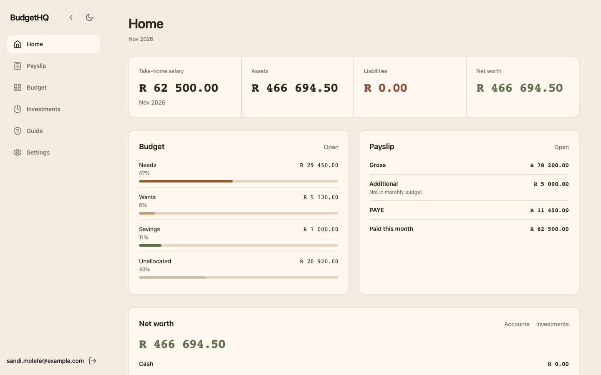
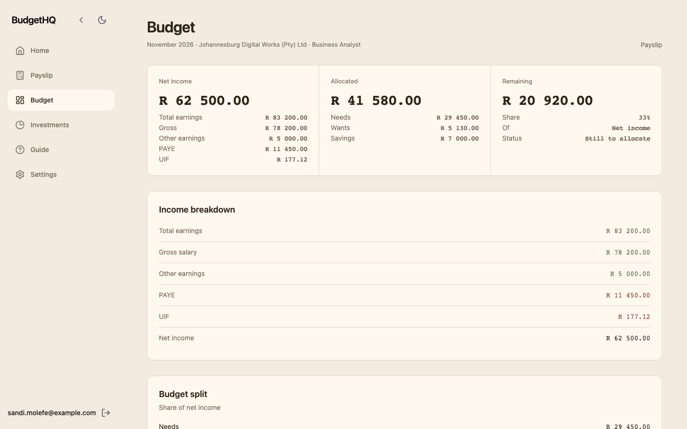
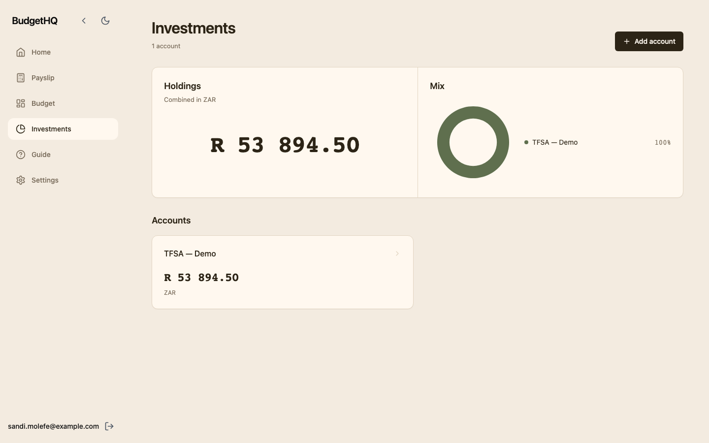
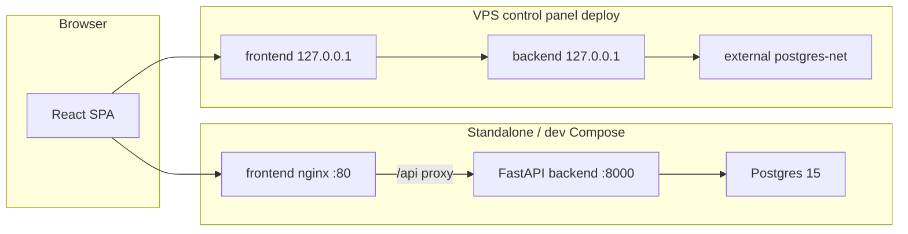

# BudgetHQ

Personal finance dashboard for **South African** users: budgeting against take-home pay, SARS-oriented payslip tooling, emergency savings and retirement annuity planning, investment portfolios (TFSA, ETFs, bonds, optional Sygnia sync), and optional Investec banking when you connect your own credentials.

[](https://github.com/andrewallkin/budgethq/actions/workflows/ci.yml)



## Overview

BudgetHQ keeps needs, wants, and savings in one place, aligned to monthly net income from payslips or manual salary entry. Investments track TFSA and other portfolios with local holdings and optional Google Sheets pricing. Auth is JWT-based with per-user data isolation.

## Features

- **Budget** — Needs / wants / savings with charts and autosave
- **Payslip & tax** — SARS-aligned PAYE/UIF tables, PDF or manual payslip capture, fringe-benefit line items
- **Emergency savings** — Targets tied to budget needs (3/6/12 months)
- **Retirement annuity** — Contributions, performance history, tax scenarios
- **Investments** — Portfolios at `/investments` (Sheets-backed ETFs, Sygnia accounts, target allocation, bonds)
- **Investec** (optional) — Account sync, transactions, rules, budget analysis when credentials are configured
- **External API** — Per-user `bhq_` API keys for bot integrations
- **Auth** — JWT login with optional username allowlist

## Screenshots

| | |
|---|---|
| Budget dashboard | Investments hub |
|  |  |

Figures in these images come from the **local seed** (synthetic data). They are not production balances.

## Architecture



- **Frontend** (`frontend/`) — React, Vite, Tailwind, Recharts. Production image serves the SPA and proxies `/api` to the backend.
- **Backend** (`backend/app/`) — FastAPI routers, SQLAlchemy models, Alembic migrations, APScheduler for price sync jobs.
- **Postgres** — Application data store. Bundled in `docker-compose.dev.yml` and `docker-compose.standalone.yml`; shared instance on the VPS via external `postgres-net` in `docker-compose.yml`.
- **Auth** — JWT issued by `/api/auth/login`; optional `AUTHORIZED_USERS` allowlist.
- **External services** — Google Sheets/GCS, OpenRouter (payslip extraction), Investec API, Sygnia portal scraping when configured.

**Control panel boundary:** On the VPS, [vps-control-panel](https://github.com/andrewallkin/vps-control-panel) deploys `docker-compose.yml` in image mode: prebuilt Docker Hub images, loopback host ports, panel-managed `.env` and migrations, nginx + Cloudflare TLS. That host config is not in this repo. **Standalone** (`docker-compose.standalone.yml`) is the self-contained path: bundled Postgres, local builds, frontend on all interfaces, backend on loopback for `/docs`.

## Technology stack

| Layer | Technologies |
|--------|----------------|
| Frontend | React 18, Vite 5, Tailwind CSS, Recharts, axios, react-router-dom |
| Backend | Python 3.11, FastAPI, SQLAlchemy, Alembic, pydantic-settings, APScheduler |
| Database | PostgreSQL 15 |
| Auth | JWT (python-jose), bcrypt passwords, optional Fernet for stored API keys |
| Integrations | Google Sheets/GCS, OpenRouter, Investec, Sygnia (Playwright) |
| Runtime | Docker Compose (dev / standalone / panel), nginx (production frontend) |

## Getting started

**Demo login (freshly seeded local database only):**

- Username: `sandi.molefe@example.com`
- Password: `demo-local-only`

```bash
cp .env.example .env
# Required: JWT_SECRET_KEY (e.g. openssl rand -hex 32)
# For open registration locally, leave AUTHORIZED_USERS unset or add the demo username.

docker compose -f docker-compose.dev.yml up --build
docker compose -f docker-compose.dev.yml exec backend uv run alembic upgrade head
docker compose -f docker-compose.dev.yml exec backend uv run python /app/scripts/seed_db.py --force
```

- **Frontend:** http://localhost:3000 (Vite HMR on port 5173 inside the container)
- **Backend / OpenAPI:** http://localhost:8000 and http://localhost:8000/docs
- **Health:** http://localhost:8000/api/health
- **Postgres (host):** `localhost:${POSTGRES_PORT:-5432}`

## Configuration

Copy [.env.example](.env.example) to `.env`. The backend builds `DATABASE_URL` from `POSTGRES_*` only. For **dev** and **standalone**, set `POSTGRES_HOST=postgres`. The **control panel** overrides production `POSTGRES_*` and `DOCKER_IMAGE_*` tags on the VPS.

## Deployment

| Mode | Compose file | Notes |
|------|----------------|-------|
| Local development | `docker-compose.dev.yml` | Hot reload, bundled Postgres |
| Standalone | `docker-compose.standalone.yml` | Production images, bundled Postgres |
| VPS (panel) | `docker-compose.yml` | External `postgres-net`, prebuilt images |

See [docs/deployment.md](docs/deployment.md) for migrate/seed commands, logs, and database backup steps.

## API

Interactive docs: **http://localhost:8000/docs** (when the backend is reachable).

| Area | Prefix / docs |
|------|----------------|
| Auth | `/api/auth/*` — register, login, user settings |
| Budget | `/api/budget/*` |
| Payslip | `/api/payslip/*` |
| Investments | `/api/investments`, `/api/investments-v2/*` |
| Emergency / RA | `/api/emergency-savings/*`, `/api/ra/*` |
| Investec | `/api/investec/*` (optional) |
| Health | `GET /api/health` |
| External bots | [external-investments-api.md](docs/external-investments-api.md), [external-budget-transactions-api.md](docs/external-budget-transactions-api.md) |

SPA routes: `/`, `/budget`, `/salary`, `/investments`, `/settings`, and optional `/investec/*`.

## Development

```bash
# Backend tests
uv sync --frozen --extra backend --extra dev
uv run pytest

# Frontend unit tests
cd frontend && npm test

# Migrations (dev stack running)
make migrate
make migrate-create MSG='short_description'

# Synthetic data + README screenshots (standalone stack)
docker compose -f docker-compose.standalone.yml up --build -d
docker compose -f docker-compose.standalone.yml run --rm --no-deps backend bash /app/run_migrations.sh
docker compose -f docker-compose.standalone.yml exec backend uv run python /app/scripts/seed_db.py --force
cd scripts && npm install && npx playwright install chromium
node ../scripts/capture-screenshots.mjs
docker compose -f docker-compose.standalone.yml down
```

Makefile helpers: `make dev-up`, `dev-build`, `dev-down`, `dev-logs`, `dev-shell`, `migrate*`, `prod-up` (panel `docker-compose.yml` against pulled images).

Product notes: [docs/](docs/) — [monthly budget income](docs/monthly-budget-income.md), [UI conventions](docs/ui.md), external API guides.